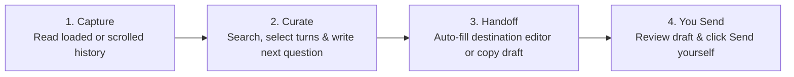
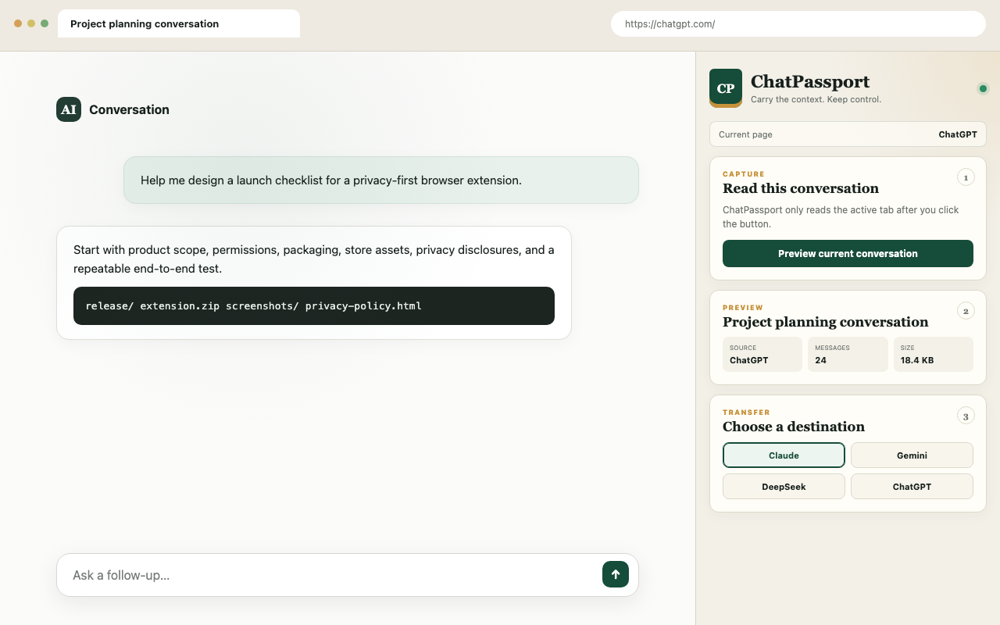
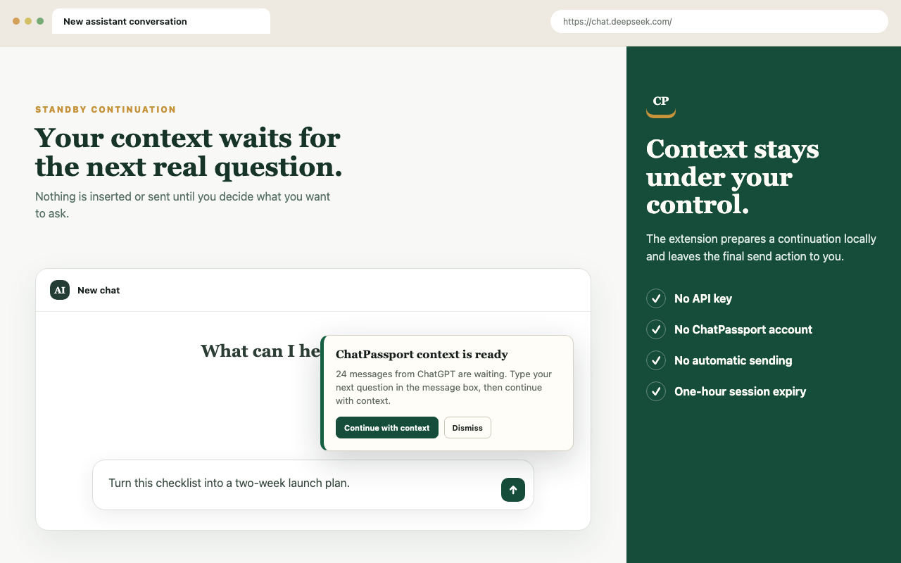
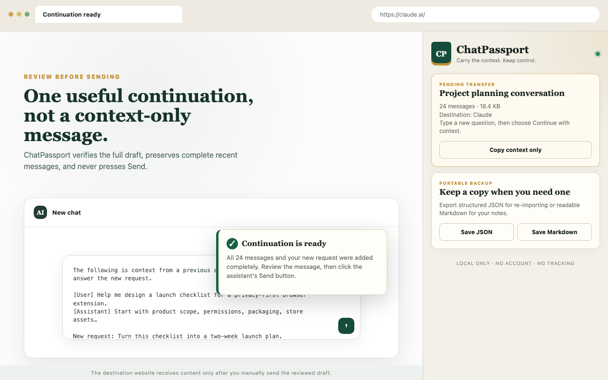
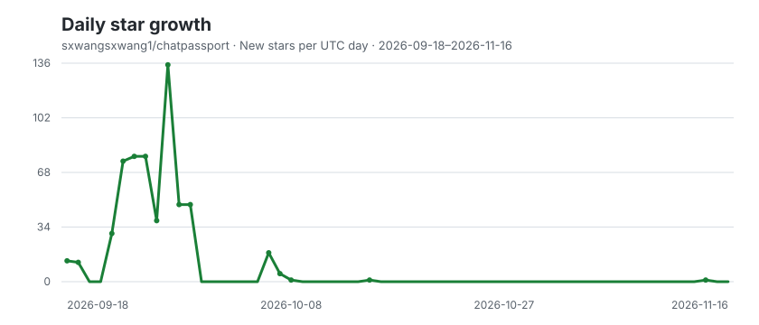

<div align="center">


# ChatPassport

### Switch assistants. Keep your context.

Continue any conversation across **ChatGPT**, **Claude**, **Gemini**, and **DeepSeek** — or branch into a fresh thread on the same assistant — without manually copy-pasting messages one by one.

<p>
  <a href="https://chromewebstore.google.com/detail/chatpassport/anmmhpfpbaafkgdhalbllhmaejeappmb">
    
  </a>
  <a href="https://github.com/sxwangsxwang1/chatpassport/stargazers">
    
  </a>
  <a href="LICENSE">
    
  </a>
  
</p>

<p>
  <a href="#why-chatpassport">Why ChatPassport</a> ·
  <a href="#how-it-works">How It Works</a> ·
  <a href="#what-moves">What Moves</a> ·
  <a href="#privacy--control">Privacy</a> ·
  <a href="#build-from-source">Build from Source</a> ·
  <a href="#star-history">Star History</a>
</p>

<br />


</div>

---

## Why ChatPassport?

Hit a message cap, want a second opinion from another model, or need a clean thread without losing hard-won decisions? ChatPassport turns a fragile copy-paste chore into a calm, inspectable 3-step handoff.

<table>
  <tr>
    <td width="50%" valign="top">
      <strong>🧭 Four assistants, any direction</strong><br />
      Move seamlessly between <strong>ChatGPT</strong>, <strong>Claude</strong>, <strong>Gemini</strong>, and <strong>DeepSeek</strong> — or open a fresh chat on your current assistant with only the context that matters.
    </td>
    <td width="50%" valign="top">
      <strong>✍️ Editable draft, never auto-sent</strong><br />
      ChatPassport inserts a structured continuation draft and verifies it landed intact. You review, tweak, and click <strong>Send</strong> yourself — or copy the prepared draft directly from the side panel.
    </td>
  </tr>
  <tr>
    <td width="50%" valign="top">
      <strong>🔍 Surgical message control</strong><br />
      Read currently loaded turns or scroll to load older history. Search full messages, toggle individual turns on the fly, and see exact size-limit omission badges before opening a tab.
    </td>
    <td width="50%" valign="top">
      <strong>🔒 100% local, zero accounts</strong><br />
      No ChatPassport account, no API keys, no backend server, no analytics. Everything runs in your browser, with light &amp; dark theme support built in.
    </td>
  </tr>
</table>

---

## How It Works



<table>
  <tr>
    <td align="center" width="33%">
      
      <br /><sub><strong>1. Capture &amp; choose destination</strong></sub>
    </td>
    <td align="center" width="33%">
      
      <br /><sub><strong>2. Write your next question</strong></sub>
    </td>
    <td align="center" width="33%">
      
      <br /><sub><strong>3. Review the draft &amp; send</strong></sub>
    </td>
  </tr>
</table>

<p align="center"><sub>Screenshots use demonstration conversation data.</sub></p>

1. **[Install ChatPassport](https://chromewebstore.google.com/detail/chatpassport/anmmhpfpbaafkgdhalbllhmaejeappmb)**, open a conversation on a [supported website](#supported-websites), and open the side panel *(if the tab was already open before install, refresh it once)*.
2. Pick a destination assistant (or **new chat** on the current one) and a capture mode, then click **Prepare**.
3. Review or search the captured transcript, select a range or toggle individual messages, write your next question, and confirm any older messages omitted by the character budget.
4. Click **Open editable draft** to fill an empty destination editor automatically — or click **Copy prepared draft** right in the side panel to paste into an existing thread or any other tool. If automatic insertion cannot complete (or the site clears the box), use **Insert prepared draft** or **Copy prepared draft** on the destination card.

> [!IMPORTANT]
> **ChatPassport never clicks Send.** Once a draft is inserted into the destination editor, the destination website may read or sync it under its own policies before you send it.

---

## Supported Websites

| Assistant | Supported Domains |
| :--- | :--- |
| **ChatGPT** | `chatgpt.com`, `chat.openai.com` |
| **Claude** | `claude.ai` |
| **Gemini** | `gemini.google.com` |
| **DeepSeek** | `chat.deepseek.com` |

Requires a Chromium browser with Chrome Manifest V3 and Side Panel support. If a site layout change affects capture or insertion, please [open an issue](https://github.com/sxwangsxwang1/chatpassport/issues) with the website and steps to reproduce *(remove any private conversation text first)*.

---

## Capture Modes

| Mode | Behavior | Best for |
| :--- | :--- | :--- |
| **Load history** *(default)* | Scrolls to collect older rendered messages, then restores your scroll position (up to 2 minutes; stop any time to keep partial results). | Longer conversations with virtualized or lazy-loaded history. |
| **Quick** | Reads only messages currently loaded in the DOM with no scrolling; coverage is marked partial. | Short chats or grabbing the latest turns instantly. |

> Websites may hide, collapse, or virtualize older turns. Even reaching both page boundaries cannot guarantee every server-side message was rendered. When a history scan reaches message-count or file-size limits, ChatPassport keeps the most recent complete messages that fit and reports the limit in the side panel.

---

## What Moves

<table>
  <tr>
    <th align="left" width="50%">✅ Included</th>
    <th align="left" width="50%">⛔ Not Included</th>
  </tr>
  <tr>
    <td valign="top">
      <ul>
        <li>Message order and roles (<code>user</code>, <code>assistant</code>, <code>system</code>)</li>
        <li>Rich Markdown: headings, lists, links, GFM tables, fenced code blocks (with language tags), and TeX math (<code>$...$</code> / <code>$$...$$</code>)</li>
        <li>Exact plain-text formatting for your own messages</li>
        <li>Text placeholders for non-decorative images (<code>[image: alt]</code> or <code>[image]</code>)</li>
      </ul>
    </td>
    <td valign="top">
      <ul>
        <li>Raw image bytes and uploaded file attachments</li>
        <li>Interactive artifacts and citation cards</li>
        <li>Hidden reasoning / chain-of-thought blocks</li>
        <li>AI-generated summaries (ChatPassport never rewrites or cuts a message in half)</li>
      </ul>
    </td>
  </tr>
</table>

### Limits & Portable Exports

| Setting | Limit / Behavior |
| :--- | :--- |
| **Destination draft budget** | Up to **48,000 characters** total, including up to **8,000 characters** for your next question. Older selected messages beyond the budget are flagged with preview badges and require explicit confirmation before opening. |
| **Complete transcript fallback** | Whenever messages are omitted or excluded, download the full captured transcript as **Markdown** to attach manually at the destination *(ChatPassport does not upload or verify attachments)*. |
| **Portable archive** | Export & re-import `.chatpassport.json` (**25 MiB** limit) or export Markdown. See [docs/format.md](docs/format.md) for the `1.0` schema. |
| **Pending transfer buffer** | Up to **9 MB** in `chrome.storage.session`, bound to a single destination tab. |

---

## Privacy & Control

- **Explicit activation only** — Reading begins only when you click **Prepare**.
- **Zero backend** — No developer-operated servers, accounts, API keys, analytics, or tracking.
- **Short-lived & tab-bound** — A pending transfer lives only in `chrome.storage.session`, is bound to one destination tab, expires automatically after **1 hour**, and clears on completion, tab close, or manual clear.
- **In-memory recovery** — After insertion, the destination card retains the prepared draft only in page memory for recovery copying until you dismiss the card or the page unloads.

Read the full [Privacy Policy](PRIVACY.md) for details.

---

## Build from Source

Requires **Node.js 22+** and **pnpm** (`packageManager` pins `pnpm@11.19.0`).

```bash
pnpm install
pnpm check
```

- `pnpm check` runs TypeScript type checking (`tsc --noEmit`), Vitest unit tests, and a production build.
- Load `.output/chrome-mv3` via `chrome://extensions` → **Developer mode** → **Load unpacked**.
- Use `pnpm dev` for live development or `pnpm release:chrome` to package an uploadable ZIP in `release/`.

---

## Star History

Thank you to everyone who has starred and shared ChatPassport!

<div align="center">
  <a href="https://star-history.com/#sxwangsxwang1/chatpassport&Date">
    <picture>
      <source media="(prefers-color-scheme: dark)" srcset="assets/star-history-dark.svg" />
      
    </picture>
  </a>
</div>

<br />

<div align="center">

[](https://github.com/sxwangsxwang1/chatpassport/stargazers)
&nbsp;·&nbsp;
[⭐ Star on GitHub](https://github.com/sxwangsxwang1/chatpassport)
&nbsp;·&nbsp;
[View Stargazers](https://github.com/sxwangsxwang1/chatpassport/stargazers)
&nbsp;·&nbsp;
[Report an Issue](https://github.com/sxwangsxwang1/chatpassport/issues)

</div>
